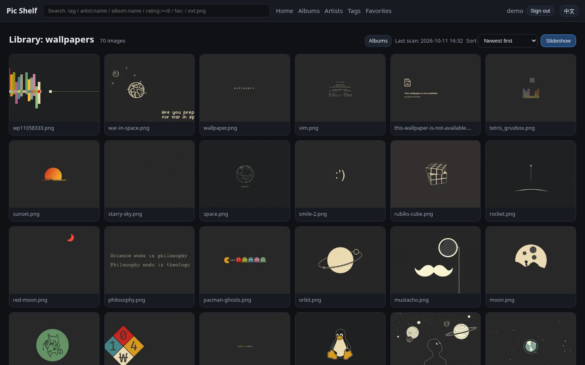

# Pic Shelf

**English** | [简体中文](README.zh-CN.md)

Self-hosted image library: import → encode (hash / thumbnails) → search / rate / tag / artists → rule-based playback.
Three frontends: **Web** (browser) / **TUI** (terminal) / **CLI** (command line — hand the playback queue straight to mpv). Desktop client planned.




> Research & competitive analysis: `docs/research/2026-10-11-open-source-image-viewers.md`
> Architecture: `docs/architecture.md` ｜ Decisions: `docs/decisions.md` ｜ Tasks: `TASKS.md` ｜ Developer entry: `AGENTS.md`
> Naming: **Pic Shelf** (collision-check record in `docs/decisions.md` D11)

## Features (status)

| Capability | Description | Status |
|---|---|---|
| Import & encode | Directory = library; SHA-256 (exact dedupe) + pHash (similarity) + WebP thumbnails & previews | ✅ |
| Managed import | Hardlink (default — originals untouched, zero extra space) / copy / move; sha256 dedupe, automatic rename on conflicts, dry-run first; **CLI + Web admin "Import" wizard** | ✅ |
| Image groups | Folder albums (automatic) + manual albums (add/remove, cover) | ✅ |
| Ratings | Per-user 0–10, personal + average | ✅ |
| Tags | Namespaced tags (`artist:name` style), autocomplete, add/remove | ✅ |
| Artists | First-class entities (aliases, links, notes) linked to images; browse / play by artist | ✅ |
| Comics / series | Album `category` field + `series:` tag convention (CBZ support on the roadmap) | ✅ basic |
| Playback | Server-side queue: timed / counted / carousel (loop) / random / cross-album / by artist; Web slideshow + mpv handoff + TUI slideshow | ✅ |
| Search | `tag`, `-tag`, `artist:`, `album:`, `rating:>=N`, `fav:`, `ext:`, `file:`, bare words | ✅ |
| User groups | Groups with a capability set (view/rate/comment/note/tag_edit/manage) + per-library grants | ✅ |
| Comments / notes | Per-image comments and text notes (on-image region notes on the roadmap) | ✅ |
| Multi-user shared libraries | Multiple users, per-library ACL, per-user ratings & favorites | ✅ |
| Encryption | scrypt passwords, HMAC-signed tokens, encrypted backup export; full-library encryption deliberately out of scope for now (see `docs/decisions.md` D1) | ✅ per D1 |
| Deployment | Docker / docker-compose ready (binds to loopback by default; no published image yet) | ✅ |
| Localization | Fully bilingual **zh / en** across Web + TUI + CLI + API errors; follows the system locale, switchable (Web header toggle; CLI `--lang` / `PICSHELF_LANG`) | ✅ |
| Local-model tagging | Auto-tagging / CLIP similarity (interface reserved, see Roadmap) | ⏳ planned |

## Quick start

```bash
git clone git@github.com:StepaniaH/pic-shelf.git
cd pic-shelf

# 1) Environment (skip when .venv already exists)
uv venv .venv && uv pip install --python .venv/bin/python -e ".[dev]"

# 2) Initialize the data directory + admin account
.venv/bin/picshelf init --admin admin

# 3) Index an existing directory (read-only scan; originals untouched)
.venv/bin/picshelf library add wallpapers "/path/to/your/images"
.venv/bin/picshelf scan wallpapers

# 3.5) …or import external directories into a managed library (dry-run first, then --apply; hardlink by default)
.venv/bin/picshelf library add mylib "~/Pictures/PicShelfLib" --mkdir
.venv/bin/picshelf import "~/incoming" mylib            # dry run
.venv/bin/picshelf import "~/incoming" mylib --apply    # execute + auto-scan
#    Or via Web: Admin → Import (dry-run table → confirm)

# 4) Pick a frontend
.venv/bin/picshelf serve            # Web: http://127.0.0.1:39431
.venv/bin/picshelf tui              # terminal UI
.venv/bin/picshelf ls               # CLI listing

# 5) Playback (filtered queue handed to mpv)
.venv/bin/picshelf play --album 1 --order shuffle --interval 8 --count 50 --loop --player mpv
```

Data lives in `./data/` inside the project by default (database, thumbnails, secret key, playlists); override with `--data DIR` or `PICSHELF_DATA`.

## Docker

```bash
docker compose up -d --build                               # build + start (binds 127.0.0.1:39431)
docker compose exec picshelf picshelf init --admin admin   # first run: initialize
```

Mount your image directories in `docker-compose.yml` (read-only is fine for index mode) and register them via `docker compose exec picshelf picshelf library add ...`. Full guide (volumes, networking, permissions, upgrades, backups): `docs/deployment.md`.

## The three frontends

- **Web**: log in and browse libraries / albums / artists / tags / favorites; grid browsing + viewer (rating / tags / comments / notes / favorite); slideshow mode (interval, count, order, loop, sizing, captions; respects the reduced-motion preference, keyboard-operable); admin pages (users / user groups / library grants / scan / import wizard).
- **TUI**: `picshelf tui` — tree browsing + list + detail + rating/tag/favorite + slideshow loop (optional in-terminal image preview).
- **CLI**: `picshelf ls|search|show|rate|tag|comment|note|play|dupes|export|import|users|groups|library|scan`.
  Playback supports `--player mpv` (generates a playlist and hands it to mpv; per-image duration / loop / shuffle controlled by flags) / `--player terminal` / `--player list`.

## Directory structure

```
picshelf/
  config.py      # data dir / port configuration
  db.py          # SQLite (WAL) + versioned migrations
  hashing.py     # SHA-256 / pHash / thumbnails
  indexer.py     # library scanning (incremental, move detection, soft delete)
  importer.py    # managed import (hardlink/copy/move, dry-run first)
  search.py      # search syntax → SQL
  auth.py        # users / groups / permissions / tokens
  play.py        # playback sessions (queue building & navigation)
  api/           # FastAPI routes (REST + static Web)
  cli.py         # command line
  tui.py         # terminal UI (Textual)
  web/           # frontend (no build step, vanilla JS)
tests/           # pytest suite
docs/            # research / architecture / decisions / screenshots
```

## Security

- The server binds to `127.0.0.1` by default and is not exposed; for remote access read `docs/decisions.md` D2/B0 first (network-exposure changes require maintainer confirmation).
- Passwords: salted scrypt hashes; session tokens: HMAC-signed with expiry.
- `picshelf export --encrypt` produces an encrypted backup (passphrase-derived key).
- Privacy: index mode never moves any file; managed import (`import`) writes only to the chosen target library directory and only when explicitly executed (hardlink by default, originals preserved); no telemetry is collected.

## Roadmap (summary)

- Managed import: tag/artist-based naming templates (CLI + Web wizard already available).
- CBZ/ZIP archive import + ComicInfo.xml metadata; video files (via mpv).
- Local models: Ollama vision auto-tagging / CLIP embedding similarity (interface reserved).
- On-image region notes (booru-style), share links, desktop client (Tauri evaluation).
- Full-library encryption: deliberately out of scope for now — trigger conditions and a zero-code migration path in `docs/decisions.md` D1.
