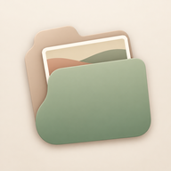

# Pic Shelf

**English** | [简体中文](README.zh-CN.md)

A self-hosted image library with Web, TUI and CLI interfaces. Browse your images,
organize them with tags and albums, and play slideshows from saved searches.
Chinese and English are supported throughout. No telemetry or external services.

[Usage](docs/usage.md) · [Deployment](docs/deployment.md) · [Architecture](docs/architecture.md) · [Contributing](CONTRIBUTING.md)

## Features

- Index an existing directory or import images by copy, hardlink or move.
- Rate, favorite and organize images with tags, artists, albums and notes.
- Edit multiple images with a preview and undo; keep track of what needs organizing.
- Search by names, ratings, dimensions and dates; save searches as smart albums.
- Save slideshow settings and resume playback in Web, TUI or mpv.
- Link file versions, move library directories, export metadata and back up the catalog.
- Share libraries with user and group permissions. See [security](docs/security.md).

## Quick start

Requires Python 3.11+ and [uv](https://docs.astral.sh/uv/).

```sh
git clone https://github.com/StepaniaH/pic-shelf.git
cd pic-shelf
uv sync --locked --extra dev --python 3.11
export PICSHELF_DATA="$PWD/data"
.venv/bin/picshelf init --admin admin
.venv/bin/picshelf library add photos /path/to/images --mode indexed
.venv/bin/picshelf scan photos
.venv/bin/picshelf serve
```

Replace `/path/to/images` with your image directory. Initialization prompts for
an administrator password of at least eight characters. Open the address printed by `serve`, or run
`.venv/bin/picshelf tui` for the terminal interface.

Originals stay in the registered directory. The data directory holds the database
and thumbnails. Use the same data directory for every command; installed packages
require `PICSHELF_DATA` or `--data`. See [installation](docs/packaging.md).

To bring files into a managed library, follow [importing](docs/usage.md#import-and-scanning).
In the web app, choose images or a folder, or drag them into the import area.
Import stays in the Add library, New album or Import images dialog, keeping the
current page open.
Local originals are kept. For files already on the server, browse to a source
folder; Pic Shelf tries hard links and copies when needed. Explicit copy/move
modes and manual server paths are available under Advanced options.

## Docker

```sh
mkdir -p data
docker compose build
printf '%s\n' "$PASSWORD" | docker compose run --rm -T picshelf picshelf init --admin admin --password-stdin
docker compose up
```

`mkdir -p data` comes first: if the directory is missing, Docker creates it as
`root`, and the container (UID 1000) cannot write to it. `docker compose up`
without `-d` shows the startup banner; add `-d` once you see it.

Mount your image directories and make the data volume writable by container UID
1000. The service binds to loopback by default. See [deployment](docs/deployment.md)
for volume configuration, remote access and upgrades. A prebuilt image is not yet published.

## Keeping your collection

Back up originals separately from the [catalog backup](docs/backups.md).
[Portable metadata](docs/metadata-format.md) transfers tags and other organization
between installations. [Diagnostics](docs/diagnostics.md) help investigate missing
files, scan errors and storage use.

Animated and multipage images use their first frame or page for previews. Format
support depends on Pillow; see [supported formats](docs/usage.md#scan-safety-and-derivative-versions).
Video and comic archives are not supported, and only regular files are read — pipes, sockets and device files are reported and skipped.
