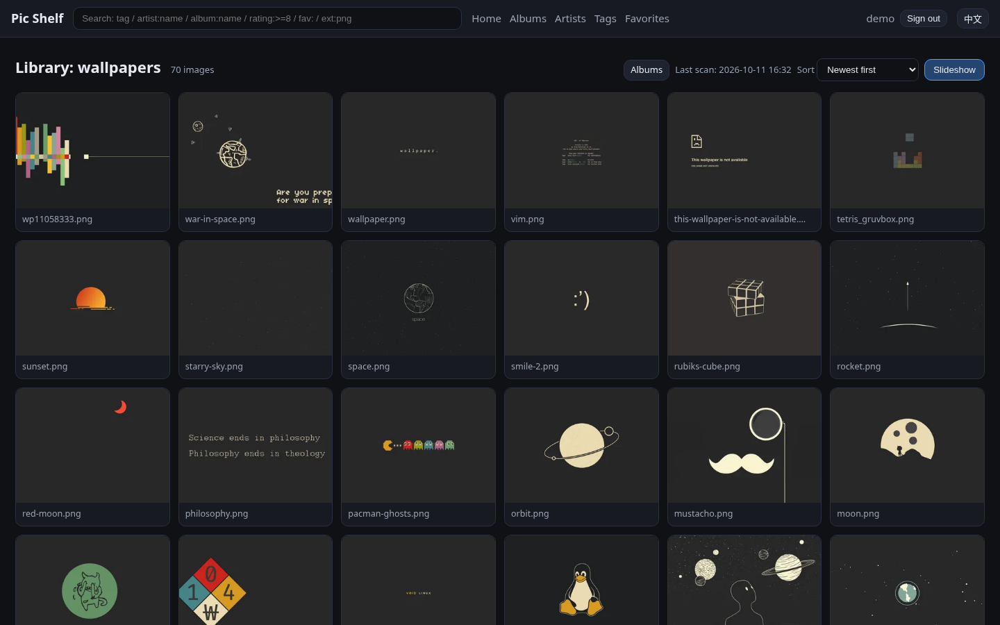
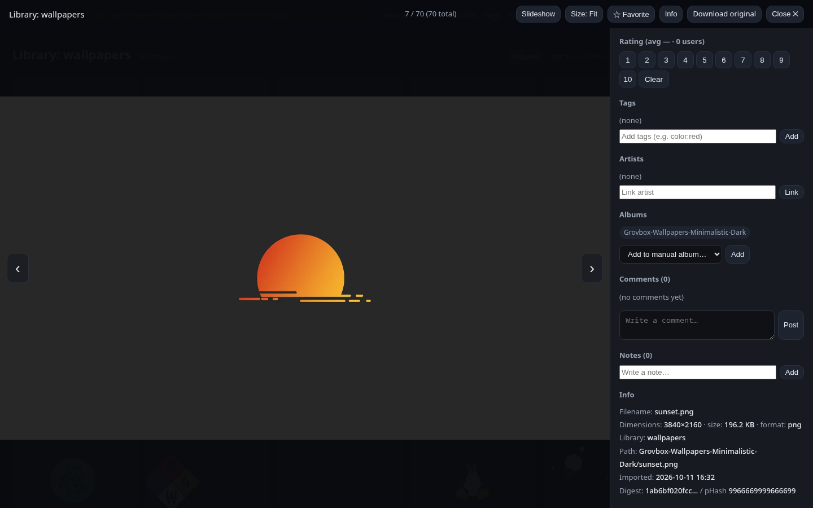

# Pic Shelf

**English** | [简体中文](README.zh-CN.md)

Pic Shelf is a self-hosted image collection for importing, organizing, finding and
viewing images. It offers a Web interface, a keyboard-driven TUI and a CLI. Image
files stay in registered library directories; metadata and derived images live
in a separate data directory. Core use is offline, with no telemetry.




[Usage](docs/usage.md) · [Deployment](docs/deployment.md) · [Security](docs/security.md) · [Contributing](CONTRIBUTING.md)

## Features

- Index existing directories without changing originals, or import into a managed
  library by hardlink, copy or move. Saved previews, background jobs, cancellation
  and retry keep file operations reviewable and recoverable. Hardlinks share bytes;
  use copy for an independent original archive.
- Per-user 0–10 ratings, favorites and explicit organization state; tags, artists,
  source records, comments, notes, folder albums and manual albums.
- Batch metadata editing with fixed selections and undo that preserves later edits.
- Validated search expressions, saved queries and dynamic smart albums.
- Saved playback rules and resumable sessions through Web, TUI or mpv. Existing
  random/shuffle modes remain without replacement; independent sampling is explicit.
- Verified root rebinding, deterministic naming templates and explicit managed-library
  reorganization that preserves image identities.
- Manual work/file-version relationships and an optional preferred viewing file.
- Portable user-scoped metadata, checked database archives and read-only diagnostics.
- Current library permissions across queries, media, jobs and exports; revocable
  sessions and Chinese/English interfaces. Intended for personal and trusted shared use.

## Quick start

Python 3.11 or later is required. The locked environment and installed artifacts
have been tested on macOS arm64 with Python 3.11; other platforms require their own
validation. See [packaging](docs/packaging.md).

```sh
git clone https://github.com/StepaniaH/pic-shelf.git
cd pic-shelf
uv sync --locked --extra dev --python 3.11
export PICSHELF_DATA="$PWD/data"
.venv/bin/picshelf init --admin admin

# Read an existing directory without moving its files.
.venv/bin/picshelf library add photos /path/to/images --mode indexed
.venv/bin/picshelf scan photos

# Or receive imports into a writable managed directory.
.venv/bin/picshelf library add collection /path/to/collection --mode managed --mkdir
.venv/bin/picshelf import /path/to/incoming collection --mode copy --json
.venv/bin/picshelf import-execute PLAN_ID --yes

.venv/bin/picshelf serve
# Alternatively: .venv/bin/picshelf tui
```

Replace the sample paths and `PLAN_ID` with the preview's values. Initialization
prompts for a password; scripts use `--password-stdin`. The Web service binds to
loopback by default. A wheel installation requires an explicit writable `--data`
or `PICSHELF_DATA`; use the same directory for all commands. Browser-selected local
paths are not uploads: import paths refer to the server's filesystem.

## Organize and keep a recoverable collection

[Batch editing](docs/batches.md), [search and playback](docs/usage.md),
[paths and naming](docs/paths.md), and [work versions](docs/works.md) explain the
daily workflows. [Portable metadata](docs/metadata-format.md) moves organization
onto independently copied originals. [Backups](docs/backups.md) preserve accounts
and the catalog; originals, signing keys and configuration have separate recovery
roles. Stop active applications before database restore. Upgrades preserve
released fields and create a migration snapshot before changing an existing schema.

`picshelf doctor` exports redacted local diagnostics; `picshelf check --full`
checks files and relationships without repair. See [diagnostics](docs/diagnostics.md)
and [performance measurements](docs/performance.md).

## Docker

```sh
docker compose build
mkdir -p data
docker compose run --rm picshelf picshelf init --admin admin
docker compose up -d
```

Set writable volume ownership for the non-root container user and mount originals
at explicit container paths. Index libraries can be read-only; managed libraries
need write access. The compose configuration binds to loopback. Current container
lifecycle verification and image publication are pending; see
[deployment](docs/deployment.md) for mounts, access, upgrade and restore steps.

## Boundaries

Originals are never included in metadata manifests or database archives. Animation
and multipage formats use the first frame/page for derivatives; the actual
[supported format behavior](docs/usage.md) is documented.
Similarity suggestions do not identify works or authorize deleting duplicates.

CBZ/ZIP reading, video indexing, model suggestions, semantic search, region notes,
public sharing and a desktop wrapper are future work. Full-library encryption is
an optional storage-layer concern; the application supports encrypted database
archives. There is no default external service, model download or telemetry.
