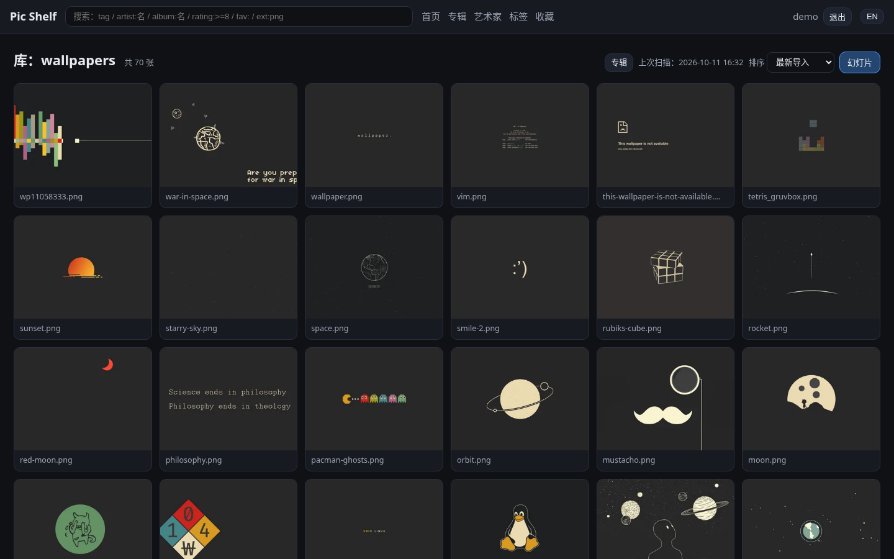
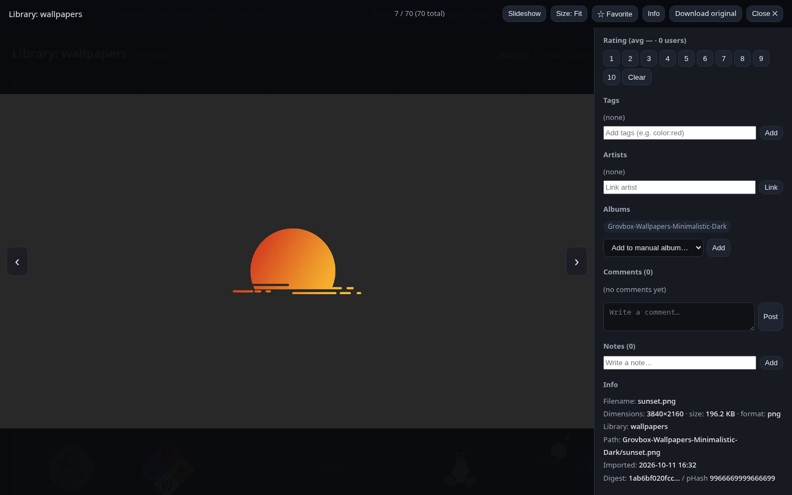

# Pic Shelf

[English](README.md) | **简体中文**

自托管图片库：导入 → 编码（哈希 / 缩略图）→ 检索 / 评分 / Tag / 艺术家 → 规则化播放。
三端界面：**Web**（浏览器）/ **TUI**（终端）/ **CLI**（命令行，可将播放队列直接交给 mpv）。桌面端规划中。




> 调研与竞品分析：`docs/research/2026-10-11-open-source-image-viewers.md`
> 架构：`docs/architecture.md` ｜ 决策：`docs/decisions.md` ｜ 任务：`TASKS.md` ｜ 开发者入口：`AGENTS.md`
> 命名：**Pic Shelf**（查重记录见 `docs/decisions.md` D11）

## 功能一览

| 能力 | 说明 | 状态 |
|---|---|---|
| 导入与编码 | 目录即库；SHA-256（精确查重）+ pHash（相似度）+ WebP 缩略图与预览图 | ✅ |
| 托管导入（v0.2） | 硬链接（默认，原文件不动、零额外空间）/ 复制 / 移动；sha256 去重、同名自动改名、预演优先；**CLI + Web 管理页「导入」向导** | ✅ |
| 图片组 | 文件夹专辑（自动）+ 手工专辑（增删、封面） | ✅ |
| 评分 | 每用户 0–10，个人分 + 平均分 | ✅ |
| 标签 | 命名空间标签（`作者:名字` 风格）、自动补全、增删 | ✅ |
| 艺术家 | 一等实体（别名、链接、备注）与图片关联；按艺术家浏览 / 播放 | ✅ |
| 漫画 / 系列 | 专辑 `category` 字段 + `series:` 标签约定（CBZ 支持在路线图上） | ✅ 基础 |
| 播放 | 服务端队列：定时 / 定量 / 轮播（循环）/ 随机 / 跨专辑 / 按艺术家；Web 幻灯片 + mpv 移交 + TUI 连播 | ✅ |
| 检索 | `tag`、`-tag`、`artist:`、`album:`、`rating:>=N`、`fav:`、`ext:`、`file:`、裸词 | ✅ |
| 用户组 | 组能力集（view/rate/comment/note/tag_edit/manage）+ 每库授权 | ✅ |
| 评论 / 笔记 | 每张图片的评论与文本笔记（图上区域注释在路线图上） | ✅ |
| 多用户共享库 | 多用户、库级 ACL、各自的评分与收藏 | ✅ |
| 加密 | scrypt 口令、HMAC 签名令牌、加密备份导出；整库加密现阶段刻意不做（见 `docs/decisions.md` D1） | ✅ 按 D1 |
| 中英双语 | **Web + TUI + CLI + API 报错**全端 zh/en；跟随系统 locale，可切换（Web 顶栏按钮；CLI `--lang` / `PICSHELF_LANG`） | ✅ |
| 本地模型识图 | 自动打标 / CLIP 相似检索（接口已预留，见路线图） | ⏳ 计划中 |

## 快速开始

```bash
git clone git@github.com:StepaniaH/pic-shelf.git
cd pic-shelf

# 1) 环境（已有 .venv 可跳过）
uv venv .venv && uv pip install --python .venv/bin/python -e ".[dev]"

# 2) 初始化数据目录 + 管理员
.venv/bin/picshelf init --admin admin

# 3) 索引一个已有目录（只读扫描，不动原文件）
.venv/bin/picshelf library add wallpapers "/path/to/your/images"
.venv/bin/picshelf scan wallpapers

# 3.5) ……或把外部目录导入托管的库（v0.2；预演优先，--apply 执行；默认硬链接）
.venv/bin/picshelf library add mylib "~/Pictures/PicShelfLib" --mkdir
.venv/bin/picshelf import "~/incoming" mylib            # 预演
.venv/bin/picshelf import "~/incoming" mylib --apply    # 执行 + 自动扫描入库
#    或走 Web：管理 → 导入（预演表格 → 确认）

# 4) 选一个前端
.venv/bin/picshelf serve            # Web: http://127.0.0.1:39431
.venv/bin/picshelf tui              # 终端界面
.venv/bin/picshelf ls               # 命令行列表

# 5) 播放（过滤后的队列交给 mpv）
.venv/bin/picshelf play --album 1 --order shuffle --interval 8 --count 50 --loop --player mpv
```

数据默认放在项目内 `./data/`（数据库、缩略图、密钥、播放列表）；可用 `--data DIR` 或 `PICSHELF_DATA` 覆盖。

**界面语言**：默认跟随系统 locale（zh* → 中文，其余 → 英文）。固定语言：`PICSHELF_LANG=zh`、`picshelf --lang zh`，或 Web 顶栏的「中/EN」按钮（浏览器内持久化）。

## 三端介绍

- **Web**：登录后浏览库 / 专辑 / 艺术家 / 标签 / 收藏；网格浏览 + 查看器（评分 / 标签 / 评论 / 笔记 / 收藏）；幻灯片模式（间隔、数量、顺序、循环、尺寸、字幕；尊重"减少动态效果"偏好，可键盘操作）；管理页（用户 / 用户组 / 库授权 / 扫描 / 导入向导）。
- **TUI**：`picshelf tui` —— 树形浏览 + 列表 + 详情 + 评分/标签/收藏 + 幻灯片连播（可选终端内图片预览）。
- **CLI**：`picshelf ls|search|show|rate|tag|comment|note|play|dupes|export|import|users|groups|library|scan`。
  播放支持 `--player mpv`（生成播放列表交给 mpv；单张时长 / 循环 / 随机由参数控制）/ `--player terminal` / `--player list`。

## 目录结构

```
picshelf/
  config.py      # 数据目录 / 端口配置
  db.py          # SQLite（WAL）+ 版本化迁移
  hashing.py     # SHA-256 / pHash / 缩略图
  indexer.py     # 库扫描（增量、移动检测、软删除）
  importer.py    # 托管导入（hardlink/copy/move，预演优先）
  search.py      # 搜索语法 → SQL
  auth.py        # 用户 / 组 / 权限 / 令牌
  play.py        # 播放会话（队列构建与导航）
  i18n.py        # 双语文案（中文 msgid → EN 目录）
  api/           # FastAPI 路由（REST + 静态 Web）
  cli.py         # 命令行
  tui.py         # 终端界面（Textual）
  web/           # 前端（零构建，原生 JS）
tests/           # pytest 测试
docs/            # 调研 / 架构 / 决策 / 截图
```

## 安全

- 服务器默认只绑定 `127.0.0.1`，不对外暴露；远程访问请先阅读 `docs/decisions.md` D2/B0（网络暴露类变更需维护者确认）。
- 口令：加盐 scrypt 哈希；会话令牌：HMAC 签名、带有效期。
- `picshelf export --encrypt` 生成加密备份（口令派生密钥）。
- 隐私：索引模式绝不移动文件；托管导入仅在被明确执行时写入目标库目录（默认硬链接、保留原文件）；零遥测。

## 路线图（摘要）

- 托管导入：基于 tag/艺术家的命名模板（CLI + Web 向导已可用）。
- CBZ/ZIP 归档导入 + ComicInfo.xml 元数据；视频文件（经 mpv）。
- 本地模型：Ollama 视觉自动打标 / CLIP 嵌入相似检索（接口已预留）。
- 图上区域注释（booru 式）、分享链接、桌面端（Tauri 评估）。
- 整库加密：现阶段刻意不做——触发条件与零代码迁移路径见 `docs/decisions.md` D1。
