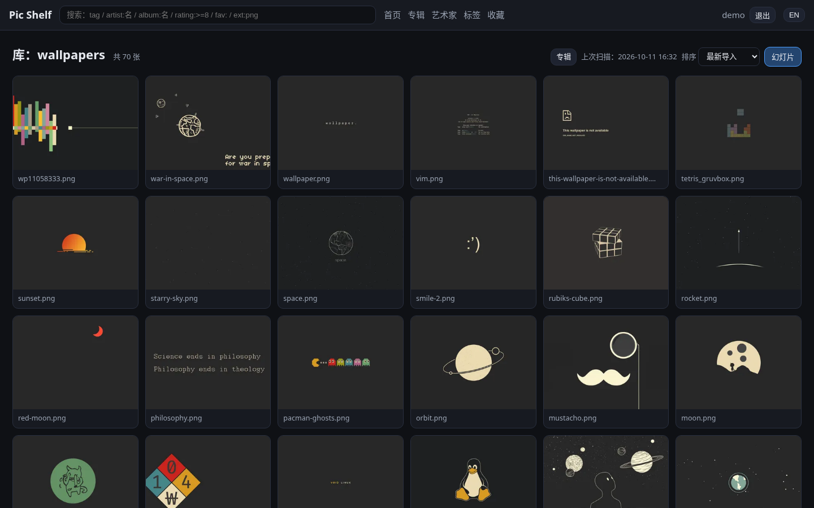
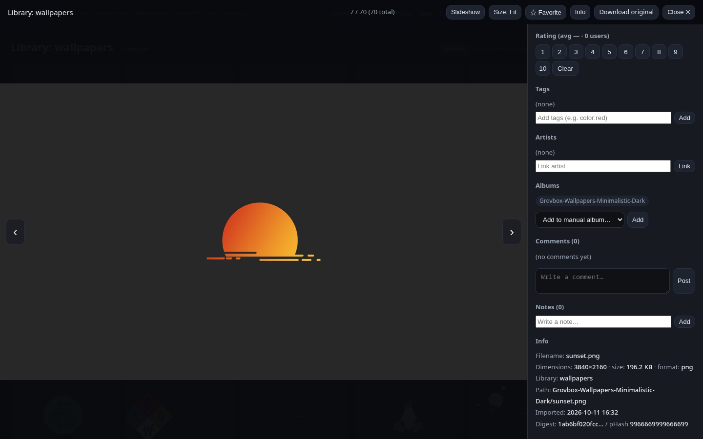

# Pic Shelf

[English](README.md) | **简体中文**

Pic Shelf 是自托管图片收藏库，提供 Web、键盘驱动的 TUI 和 CLI，用于导入、整理、检索与观看图片。原图保存在注册的库目录中，元数据与派生图放在独立的数据目录。核心流程可离线使用，零遥测。




[使用说明](docs/usage.md) · [部署](docs/deployment.md) · [权限与安全](docs/security.md) · [参与开发](CONTRIBUTING.md)

## 功能

- 只索引已有目录，或通过硬链接、复制、移动收纳到托管库。导入保存预演，支持后台任务、取消与重试。硬链接共享文件内容；需要独立副本时选择 copy。
- 每用户 0–10 分、收藏与明确的整理状态；标签、艺术家、来源、评论、笔记、文件夹专辑及手工专辑。
- 固定范围的批量元数据编辑，撤销时保留后续修改。
- 有校验的搜索表达式、保存查询与动态智能专辑。
- 保存播放规则、恢复播放会话，可通过 Web、TUI 或 mpv 观看。原 random/shuffle 仍是不放回队列，独立随机抽样有明确选项。
- 核验副本后重绑定库根目录、确定性的命名模板，以及保留图片身份的托管库显式重组。
- 手工作品与文件版本关联，可设置首选观看文件。
- 可移植个人元数据、带校验的数据库备份，以及只读检查与脱敏诊断。
- 查询、媒体、任务与导出遵守当前库权限；会话可撤销，界面中英双语。面向个人与可信共享使用。

## 快速开始

需要 Python 3.11 或更新版本。当前锁环境和安装产物已在 macOS arm64 / Python 3.11 运行；其他平台需独立验证，见[打包说明](docs/packaging.md)。

```sh
git clone https://github.com/StepaniaH/pic-shelf.git
cd pic-shelf
uv sync --locked --extra dev --python 3.11
export PICSHELF_DATA="$PWD/data"
.venv/bin/picshelf init --admin admin

# 原地索引，不移动文件。
.venv/bin/picshelf library add photos /path/to/images --mode indexed
.venv/bin/picshelf scan photos

# 或注册可写托管库，检查预演后执行。
.venv/bin/picshelf library add collection /path/to/collection --mode managed --mkdir
.venv/bin/picshelf import /path/to/incoming collection --mode copy --json
.venv/bin/picshelf import-execute PLAN_ID --yes

.venv/bin/picshelf serve
# 也可以运行：.venv/bin/picshelf tui
```

替换示例路径与预演返回的 PLAN_ID。初始化会交互输入密码；脚本使用 `--password-stdin`。Web 默认绑定本机。安装 wheel 后必须通过 `--data` 或 `PICSHELF_DATA` 指定可写的数据目录，所有命令使用同一路径。导入路径属于服务端文件系统，浏览器本地路径不等于上传。

## 整理与迁移

[批量整理](docs/batches.md)、[检索与播放](docs/usage.md)、[路径与命名](docs/paths.md)、[作品版本](docs/works.md)说明日常流程。[可移植元数据](docs/metadata-format.md)可以将整理结果恢复到独立复制的原图；[数据库备份](docs/backups.md)保存账号与目录。原图、签名密钥和配置分别备份。恢复数据库前停止所有应用；升级保留已发布字段，并在修改已有数据库前保存迁移快照。

`picshelf doctor` 输出脱敏的本地诊断；`picshelf check --full` 只检查，不自动修复。容量统计区分数据库、缓存、备份与开发产物；缓存清理仅提供只读候选预览。见[诊断说明](docs/diagnostics.md)与[性能测量](docs/performance.md)。

## Docker

```sh
docker compose build
mkdir -p data
docker compose run --rm picshelf picshelf init --admin admin
docker compose up -d
```

为非 root 容器用户设置可写卷权限，并使用明确的容器内挂载路径。索引库可以只读；托管库需要写权限。Compose 默认绑定本机。本次容器生命周期尚未验证，镜像未发布；挂载、访问、升级和恢复见[部署说明](docs/deployment.md)。

## 能力边界

元数据清单与数据库备份不包含原图。动画与多页格式的派生图使用首帧或首页，实际格式行为见[使用说明](docs/usage.md)。相似建议不代表同一作品，也不意味着可以删除重复文件。

CBZ/ZIP 阅读、视频、本地模型建议、语义检索、区域笔记、公开分享和桌面包装属于后续扩展。整库加密可在存储层处理，应用支持数据库备份加密。默认不依赖外部服务、不下载模型、不收集遥测。
